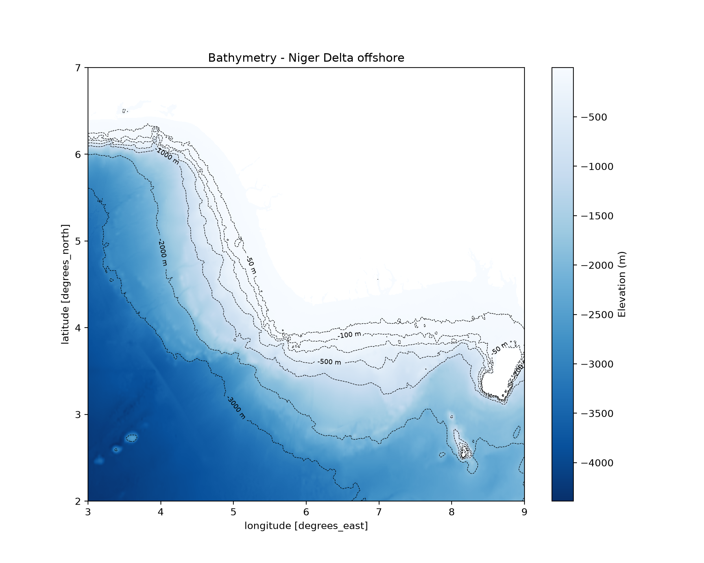

# Niger-Delta-Bathymetry
Niger Delta Offshore Bathymetry Bathymetric map and seabed profile of the Niger Delta continental margin using the GEBCO_2026 grid and Python (xarray, matplotlib). Shows the continental shelf, shelf break and deep basin (max depth ~4,389 m). Data: GEBCO Compilation Group (2026) GEBCO_2026 Grid.

